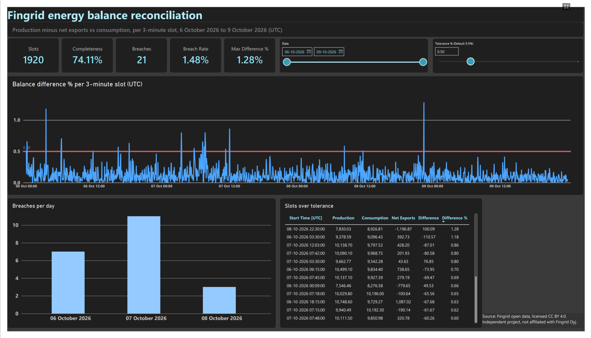

# Fingrid Energy Balance Reconciliation

[](https://github.com/m-kamaleshwar/fingrid-energy-reconciliation/actions/workflows/ci.yml)


[](LICENSE)

Does Finland's real-time electricity balance actually add up? This project pulls Fingrid's open grid data, reconciles production, consumption and cross-border flows, and finds out where, and why, the numbers disagree.

> **Status: version 2.1.** The same 3-minute reconciliation is built three times, independently: in Python with pandas, in Snowflake SQL, and as dbt models on DuckDB with automated tests. All three agree on every figure. Unit tests and the full dbt build run in GitHub Actions on every push, and the results are published as a Power BI report. **Next: the 15-minute models in dbt, and running the same dbt models on Snowflake.**



**Want to run it right now?** The dbt version needs no API key and no Snowflake account — see [Try it without an API key](#try-it-without-an-api-key).

---

## What the project does

Electricity in a grid has to balance. At any moment, what Finland produces, minus what it exports, should equal what it consumes:

```
production - net exports = consumption
```

Fingrid publishes each of these as a separate real-time dataset. If the data is complete and consistent, the balance should close within a small tolerance. Where it doesn't, something is wrong with the data, and finding out what is the point of this project.

## What the data revealed

The figures below cover 1 to 10 October 2026: 4,320 three-minute slots, reconciled independently in Python and Snowflake with identical results. The ten-day period gives the findings the widest evidence base; the shorter default period of 6 to 10 October, used in [Check the results](#6-check-the-results) and in the three-way comparison, is what a reader can reproduce quickly, so its counts are smaller.

**1. The API's paging information understates the data.** A five-day request for North Sweden data, with 1,000 rows per page, reported **2 pages and a total of 2,000 rows**. Code that trusted this stopped after page 2 and silently lost the oldest **173 rows**, about 8%, and a check against the API's reported total couldn't catch it, because it used the same wrong number. A suspiciously round row count exposed the problem. Testing showed the pattern clearly: with 500 rows per page the API reported 1,000 rows, with 1,000 it reported 2,000, and with 20,000 it returned all 2,173, while requesting page 3 directly returned the missing 173 rows. When a query has more than two pages, the reported page count and total cover only the first two. Fingrid's open data team, contacted about the issue, pointed towards further pages and the 20,000-row maximum page size. The pipeline now uses that page size, keeps requesting pages until a short page comes back rather than trusting the reported count, and treats the reported total only as a minimum.

**2. About a fifth of real-time readings are missing.** **924 production readings (21%)** and **829 consumption readings (19%)** were missing.

**3. Some moments have no data at all.** **149 slots, about 3.4%,** had no reading in any of the six real-time datasets. These system-wide gaps only become visible when the data is compared against the full grid of slots that *should* exist.

**4. Some records claim to last 6 minutes, and their end times are wrong.** My first assumption was that these were genuine 6-minute averages, so I split each into two 3-minute slots. That created **overlapping intervals**, because most of them covered a slot that already had its own reading. The reconciliation itself settled the question: the split values broke the balance by up to **146 MW**, while each slot's own reading closed it to about **6 MW**. They are ordinary 3-minute readings with an end time 3 minutes too late. The pipeline corrects and labels them, and the corrected records now reconcile just like original readings: **1 breach in 88**, about 1.1%, the same rate as original data.

**5. Filling gaps was tested and switched off.** Where a corrected record's next slot had no reading, the value could be carried forward to fill it. Tested over both periods, filled values breached tolerance in **4 of 9 reconcilable cases, about 44%**, against about 1% for original readings. Filled values in consumption and the border datasets caused false breaches too, and the largest difference in the whole test, 210 MW, was a filled value. Switching filling off brought the maximum down to 110.57 MW. The logic stays in the code, behind the `FILL_GAPS` switch and in an unused SQL procedure, so the decision and its evidence stay visible.

**6. A small, genuine imbalance remains.** **34 of 3,108 complete slots, about 1.1%,** exceeded the 0.5% tolerance, with a maximum difference of **110.57 MW**, about 1.2% of production. These use only original or corrected readings, so they reflect the source data, not this pipeline's processing.

**7. 15-minute averages can mislead.** On 1 to 6 October, the largest 15-minute difference, 168 MW, was more than twice the largest 3-minute difference, although averaging should smooth differences out. The cause is averages built from different numbers of readings, covering different moments. Across both periods, only **137 of 864 windows (about 16%)** had all five readings in all six datasets, and **all 17 fifteen-minute breaches were in incomplete windows**, including the 168 MW one. Complete windows never exceeded 37 MW. Excluding incomplete windows would discard most of the data, so the pipeline keeps every window and reports complete and incomplete windows separately.

**8. Missing data can easily pass as real data.** At one point, treating missing border readings as zero created 12 false breaches and a false maximum difference of 1,196 MW. Both pipelines now keep missing values blank, so a gap can never pass as a measurement.

## The Power BI report

`powerbi_dashboard/fingrid_reconciliation.pbix` presents the reconciliation visually: the balance over time, where it breaches tolerance, how much data is missing, and the breakdown of readings by end-time status. The same report is in the folder as a PDF and a PNG, so the results can be read without opening Power BI.

The report reads **CSV files, not a live warehouse.** `export_marts.py` writes the dbt output tables out of `fingrid.duckdb` into `exports/`:

```bash
python export_marts.py              # overwrite the CSVs with the current tables
python export_marts.py --merge      # keep older history already in the CSVs
```

Those CSVs are committed to the repository on purpose. It means the report opens and refreshes for anyone who clones this project, with no Snowflake account, no DuckDB file and no credentials of any kind, and the figures on screen are the same ones the dbt tests ran against. `--merge` is for daily runs where dbt only rebuilds a recent window: rows outside the newly built range are kept and rows inside it are replaced, so reruns never duplicate a slot.

## How it works

**Extract (Python).** `fingrid_api.py` fetches each dataset in 30-day chunks with Fingrid's maximum page size of 20,000 rows, so a chunk normally fits on one page. It keeps requesting pages until a short page comes back, rather than trusting the API's page count, waits 2 seconds between requests to respect Fingrid's rate limit, and stops on any API error, or if it receives fewer rows than the API reports.

**Reconcile (pandas).** `reconcile_pandas.py` gives every reading its own 3-minute slot, correcting and labelling the 6-minute records. It joins all datasets onto the **expected grid** of slots, keeps 3-minute and 15-minute data in separate tables, and calculates the balance for each slot against a tolerance of 0.5% of production. Each 15-minute average records how many readings it used, and each window is flagged as complete or incomplete.

**Load (Snowflake).** `load_to_snowflake.py` loads the raw API data unchanged into `STG_FIN_GRID.RAW.FINGRID_READINGS`. Loads are **idempotent**: each run deletes the period it covers before reloading it, so rerunning never creates duplicates. After loading, it checks that Snowflake holds exactly the rows that were fetched.

**Transform (Snowflake SQL).** Stored procedures repeat the same steps inside the warehouse, in layers: `CORE` normalises and aggregates the readings, `RECON` holds the reconciliation, and `OPS.RUN_FINGRID_PIPELINE` runs everything in order. Every procedure is idempotent by period.

**Transform (dbt on DuckDB).** The same reconciliation is rebuilt as dbt models, developed locally on DuckDB, free and fast. `load_to_duckdb.py` loads the raw data, stored in UTC, and the models follow the same layers: **staging** labels each reading with its dataset, **intermediate** applies the end-time correction and builds the expected grid of slots, and the **mart** calculates the balance for every slot. Each rule is a dbt test: one row per slot, no duplicate readings, a complete grid, and a tolerance check. The tolerance test **warns rather than fails**, because real data has genuine breaches, and stores the failing rows in a table for investigation.

**Tested and built automatically (GitHub Actions).** `.github/workflows/ci.yml` runs on every push to `main` and on every pull request:

1. `pytest` runs the unit tests in `tests/test_fingrid_api.py`, which cover the paging logic, chunking and error handling without calling the live API.
2. `ci/make_sample_db.py` builds a small DuckDB file from fixed sample data, so the pipeline can be exercised **without an API key or any secret**.
3. `dbt build` runs every model and every test against that file.
4. `dbt docs generate` builds the documentation site, and on a push to `main` it is deployed to GitHub Pages, giving a browsable view of the models, their lineage and their tests.

<!-- Once GitHub Pages is enabled for this repository, link the generated docs site here:
**Model documentation and lineage:** https://m-kamaleshwar.github.io/fingrid-energy-reconciliation/ -->

**Cross-checked three ways.** The pandas, Snowflake SQL and dbt versions were built independently. For 6 to 10 October 2026, all three agree exactly:

| Measure | pandas | Snowflake SQL | dbt on DuckDB |
|---|---|---|---|
| 3-minute slots | 1,920 | 1,920 | 1,920 |
| Production missing | 394 | 394 | 394 |
| Consumption missing | 344 | 344 | 344 |
| Slots over the 0.5% tolerance | 21 | 21 | 21 |
| Maximum difference | 110.57 MW | 110.57 MW | 110.57 MW |

The pandas and Snowflake versions also agree on a second period, 1 to 6 October, including the breakdowns by status and by 15-minute window completeness.

## Datasets

| ID  | Dataset | Resolution | Used for |
|-----|---------|------------|----------|
| 192 | Electricity production in Finland, real-time | 3 min | Balance |
| 193 | Electricity consumption in Finland, real-time | 3 min | Balance |
| 87  | Transmission between Finland and Northern Sweden (SE1), real-time | 3 min | Net exports |
| 89  | Transmission between Finland and Central Sweden (SE3), real-time | 3 min | Net exports |
| 180 | Transmission between Finland and Estonia, real-time | 3 min | Net exports |
| 187 | Transmission between Finland and Norway, real-time | 3 min | Net exports |
| 74  | Electricity production in Finland | 15 min | Real-time vs measured *(extracted; comparison still to come)* |
| 124 | Electricity consumption in Finland | 15 min | Real-time vs measured *(extracted; comparison still to come)* |

All values are average power in MW. For the border datasets, a positive value means transmission **from** Finland, in other words export.

## Project structure

```
fingrid-energy-reconciliation/
├── README.md
├── LICENSE                     # MIT
├── requirements.txt
├── requirements-dev.txt        # pytest and other development-only packages
├── pytest.ini                  # test discovery settings
├── fingrid_api.py              # shared: dataset list, chunked API calls, robust paging, checks
├── reconcile_pandas.py         # reconciliation in pandas
├── load_to_snowflake.py        # loads raw API data into Snowflake
├── load_to_duckdb.py           # loads raw API data into a local DuckDB file
├── export_marts.py             # exports the dbt output tables to CSV for Power BI
├── verify_duckdb_all_counts.py # prints the dbt results summary, for cross-checking
├── verify_duckdb.py            # lists the slots stored by the tolerance test
├── .github/
│   └── workflows/
│       └── ci.yml              # unit tests, dbt build, and the docs site deployment
├── ci/
│   └── make_sample_db.py       # builds a sample DuckDB file for CI, no API key needed
├── tests/
│   └── test_fingrid_api.py     # unit tests for paging, chunking and error handling
├── dbt/
│   ├── dbt_project.yml         # period and tolerance settings, materialisations
│   ├── profiles.yml            # connection to the local DuckDB file (no secrets)
│   ├── seeds/                  # list of datasets, IDs and intervals
│   ├── models/
│   │   ├── staging/            # raw readings, labelled
│   │   ├── intermediate/       # end-time correction, expected grid
│   │   └── marts/              # the 3-minute reconciliation
│   └── tests/                  # one test per rule
├── exports/                    # the dbt marts as CSV, the Power BI data source
│   ├── fingrid_datasets.csv
│   ├── int_readings_3min.csv
│   └── recon_3min.csv
├── powerbi_dashboard/
│   ├── fingrid_reconciliation.pbix                 # the report
│   ├── fingrid_reconciliation_report_overview.pdf  # the report, exported
│   └── fingrid_reconciliation_report_overview.png  # the screenshot shown above
└── sql/
    ├── 01_setup_database.sql       # database, schemas, raw and reference tables
    ├── 02_core_normalize_3min.sql  # end-time correction (and the unused fill step)
    ├── 03_core_aggregate_15min.sql # 15-minute averages with reading counts
    ├── 04_recon_3min.sql           # 3-minute reconciliation on the expected grid
    ├── 05_recon_15min.sql          # 15-minute reconciliation with window flags
    ├── 06_ops_run_pipeline.sql     # runs the pipeline in order
    └── 99_validation_checks.sql    # checks to run after each load and pipeline run
```

## Roadmap

- [x] Extract all eight datasets from the Fingrid API, with robust paging, error handling and chunking
- [x] Detect and correct incorrect end times and overlapping intervals
- [x] Reconcile the energy balance against an expected grid, with tolerance checks
- [x] Test gap filling, and switch it off on the evidence
- [x] Record how many readings each 15-minute average uses, and flag incomplete windows
- [x] Load raw data into Snowflake, idempotently, with a row-count check
- [x] Rebuild the reconciliation in Snowflake SQL and cross-check it against pandas on two periods
- [x] Rebuild the 3-minute reconciliation as **dbt** models on DuckDB, with each rule as a **dbt test**, cross-checked against pandas and Snowflake
- [x] Cover the API layer with unit tests, and add CI with GitHub Actions running `pytest` and `dbt build` on every push, with no API key needed
- [x] Publish the dbt documentation site automatically from CI
- [x] Build a **Power BI** report on the dbt output, with committed CSV exports so it opens without credentials
- [ ] Compare real-time with measured 15-minute production and consumption
- [ ] Add the 15-minute models and their tests to dbt
- [ ] Run the same dbt models on Snowflake, and compare runtime and cost with DuckDB
- [ ] Backfill a longer history
- [ ] Schedule the pipeline

---

## Setup and run, step by step

### Try it without an API key

The dbt version runs on a sample database built from fixed data, so it needs no Fingrid key, no Snowflake account and no secrets. This is exactly what CI runs:

```bash
python -m pip install -r requirements.txt -r requirements-dev.txt
pytest -v
python ci/make_sample_db.py
cd dbt
dbt build --profiles-dir .
```

`dbt build` runs every model and every test, including the seeds. The period comes from `dbt/dbt_project.yml`; to change it, edit that file, or pass `--vars` on the command line. Everything below is only needed to run against live Fingrid data or Snowflake.

### 1. Generate a Fingrid API key

- 1.1 Register with your email on [Fingrid's open data website](https://data.fingrid.fi) for API access.
- 1.2 Sign in to the Open Data portal.
- 1.3 Go to the Developer portal via the Control panel.
- 1.4 Sign in there again, separately.
- 1.5 Go to **Products**, then subscribe to **Open Data Starter**. Note: you need to give the subscription a name.
- 1.6 Go to your **Profile** page to find your API keys.

### 2. Save your credentials as environment variables

The scripts read all credentials from environment variables, so no key or password is ever written in the code.

| Variable name | Value |
|---|---|
| `FINGRID_API_KEY` | Your Fingrid API key |
| `SNOWFLAKE_USER` | Your Snowflake username |
| `SNOWFLAKE_PASSWORD` | Your Snowflake password |
| `SNOWFLAKE_ACCOUNT` | Your Snowflake account identifier |

<details>
<summary><strong>Windows</strong></summary>

- 2.1 In Windows search, type **Environment variables**.
- 2.2 Click **Edit environment variables for your account**.
- 2.3 You'll see two lists. Under the **top** list, click **New**.
- 2.4 Enter the variable name `FINGRID_API_KEY`, and as the value, the API key from step 1.6. Click **OK**.
- 2.5 Add the other variables from the table above one by one, repeating steps 2.3 and 2.4.
- 2.6 Finally, click **OK** to save and close the window.
- 2.7 **Restart your terminal or VS Code.** Programs that were already open can't see newly added variables.

</details>

<details>
<summary><strong>macOS or Linux</strong></summary>

Set them in the terminal, for example:

```bash
export FINGRID_API_KEY=your_key
```

To keep them between sessions, add the same lines to `~/.zshrc` or `~/.bashrc`.

</details>

### 3. Install Python and the packages

- 3.1 Install **Python 3.12** from [python.org](https://www.python.org). On Windows, tick **Add Python to PATH** during installation.
- 3.2 Download or clone this repository, and open a terminal in its folder.
- 3.3 Install the packages:
  ```bash
  python -m pip install -r requirements.txt
  ```
  Using `python -m pip` makes sure the packages go into the same Python that runs the scripts. This also installs **dbt with the DuckDB adapter**, which includes DuckDB itself. Add `-r requirements-dev.txt` as well if you want to run the tests.
- 3.4 Optional but recommended: use a virtual environment, so this project's packages stay separate:
  ```bash
  python -m venv .venv
  ```
  Activate it with `.venv\Scripts\Activate.ps1` on Windows, or `source .venv/bin/activate` on macOS or Linux.

### 4. Set up Snowflake

- 4.1 Create a Snowflake account. A free trial works.
- 4.2 In Snowsight, open a new SQL worksheet.
- 4.3 Run the scripts in the `sql` folder in numbered order, `01` to `06`. They create the `STG_FIN_GRID` database, its schemas (`RAW`, `REF`, `CORE`, `RECON`, `OPS`), the reference table of datasets, the tables and the pipeline procedures. All scripts are safe to rerun: tables are only created if they don't exist, so existing data is kept.
- 4.4 Optional but recommended: show times in UTC, so they match the Python output.
  ```sql
  ALTER USER <your_username> SET TIMEZONE = 'UTC';
  ```

To keep costs low on a trial, use an **XSMALL** warehouse with **auto-suspend** set to 60 seconds.

### 5. Run the pipeline

- 5.1 **Reconcile in Python:**
  ```bash
  python reconcile_pandas.py --start 2026-10-06T00:00:00Z --end 2026-10-10T00:00:00Z
  ```
  The results print to the terminal and are saved to `output.txt`.
- 5.2 **Load the raw data into Snowflake:**
  ```bash
  python load_to_snowflake.py --start 2026-10-06T00:00:00Z --end 2026-10-10T00:00:00Z
  ```
  The script finishes by checking that the row counts in Snowflake match what it fetched.
- 5.3 **Run the Snowflake pipeline** in a worksheet:
  ```sql
  CALL STG_FIN_GRID.OPS.RUN_FINGRID_PIPELINE(
      '2026-10-06T00:00:00Z'::TIMESTAMP_TZ,
      '2026-10-10T00:00:00Z'::TIMESTAMP_TZ
  );
  ```

- 5.4 **Load the raw data into a local DuckDB file,** for the dbt version:
  ```bash
  python load_to_duckdb.py --start 2026-10-06T00:00:00Z --end 2026-10-10T00:00:00Z
  ```
  This creates `fingrid.duckdb` with the raw data. Like the Snowflake loader, it replaces the period on each run and checks the row count.
- 5.5 **Build and test the dbt models:**
  ```bash
  cd dbt
  dbt seed --profiles-dir .
  dbt build --profiles-dir .
  ```
  `dbt build` runs the models and all their tests in order. The period is set in `dbt/dbt_project.yml`, or on the command line with `--vars`. Once the data is loaded, this step works entirely offline.
- 5.6 **Refresh the Power BI data,** if you want the report to show your run rather than the committed exports:
  ```bash
  python export_marts.py
  ```
  Then open `powerbi_dashboard/fingrid_reconciliation.pbix` and refresh.

Dates are in UTC, and the end date is exclusive. Without `--start` and `--end`, the scripts use 6 to 10 October 2026. Any length of period works: the scripts fetch long periods in chunks automatically.

### 6. Check the results

Run the queries in `sql/99_validation_checks.sql`. For 6 to 10 October 2026, you should see:

| Check | Expected |
|---|---|
| 3-minute slots in the reconciliation | 1,920 |
| 15-minute blocks starting only at :00, :15, :30, :45 | Yes |
| Duplicate readings or 15-minute blocks | None |
| Production readings missing | 394 |
| Consumption readings missing | 344 |
| Slots with no reading in any dataset | 67 |
| Slots exceeding the 0.5% tolerance | 21 |
| Maximum absolute difference | 110.57 MW |
| Complete 15-minute windows | 72 of 384 |

The Python summary in `output.txt` should show exactly the same numbers.

**For the dbt version,** run `python verify_duckdb_all_counts.py` from the project folder. It reads the dbt results and prints the same summary: 1,920 slots, 394 and 344 missing readings, 21 slots over tolerance, and a maximum difference of 110.57 MW. `python verify_duckdb.py` lists the slots stored by the tolerance test.

---

## Data source and licence

Data: [Fingrid Oyj open data](https://data.fingrid.fi), licensed under Creative Commons Attribution 4.0 (CC BY 4.0). This project is independent and not affiliated with Fingrid.

Code in this repository is released under the [MIT licence](LICENSE).
